# VCF Converter — System Architecture & Codebase Deep Dive

> Comprehensive analysis of the file relationships, component hierarchy, data pipelines, and internal mechanisms of the **VCF Converter** application.

---

## 1. Executive Summary & Core Philosophy

**VCF Converter** is a privacy-first, zero-backend, client-side web application designed to transform spreadsheet contact exports (`.csv`, `.xlsx`, `.xls`, `.txt`) into standardized vCard (`.vcf`) files (vCard Version 3.0).

### Key Architectural Tenet: 100% Client-Side Privacy
Unlike conventional online format converters that upload user files to a cloud server or execute background Python/Pandas jobs, this architecture executes **entirely within the user's web browser**:
- **Zero Data Egress:** No contact lists, names, phone numbers, or emails ever leave the browser.
- **Air-Gapped Operation:** Once the single-page application is loaded, the converter can function without an active internet connection.
- **Native Web APIs:** Parsing, string compilation, binary blob creation, and file downloads are orchestrated via client-side JavaScript (`FileReader`, `Blob`, `URL.createObjectURL`, `PapaParse`, `SheetJS XLSX`).

---

## 2. Technology Stack & Key Dependencies

| Layer | Technology | Version | Purpose |
| :--- | :--- | :--- | :--- |
| **Framework** | [Next.js](https://nextjs.org/) (App Router) | `16.2.9` | SSR/SSG, routing, metadata management, SEO static rendering |
| **Core UI Library** | [React](https://react.dev/) | `19.2.4` | Component state, hooks, DOM lifecycle |
| **Language** | [TypeScript](https://www.typescriptlang.org/) | `6.0.3` | Static typing, interface definitions |
| **Styling** | [Tailwind CSS v4](https://tailwindcss.com/) + CSS variables | `^4.0.0` | Theme tokens (OKLCH color system), responsive utilities |
| **Animations** | [Framer Motion](https://www.framer.com/motion/) | `^12.42.0` | Layout transitions, trust badge loops, interactive micro-animations |
| **File Drag & Drop** | [react-dropzone](https://react-dropzone.js.org/) | `^15.0.0` | Accessible drag-and-drop file target & mime-type validation |
| **CSV Parsing** | [PapaParse](https://www.papaparse.com/) | `^5.5.4` | Robust RFC-compliant CSV & TSV delimiter parsing with header extraction |
| **Excel Parsing** | [SheetJS (xlsx)](https://docs.sheetjs.com/) | `^0.18.5` | In-memory binary parsing for `.xlsx` and legacy `.xls` workbooks |
| **Component Primitives** | [Radix UI / Base UI / shadcn](https://ui.shadcn.com/) | `^4.11.0` | Accessible Accordion, Select, Card, Badge, and Input primitives |
| **Notification / Toasts**| [Sonner](https://sonner.emilkowal.ski/) | `^2.0.7` | High-performance toast alerts for upload states and errors |
| **Icons** | [Lucide React](https://lucide.dev/) | `^1.21.0` | SVG icons across navigation, hero, and features |

---

## 3. High-Level File Map & Project Organization

```
vcf-converter/
├── ARCHITECTURE.md                  # This architectural reference documentation
├── instruction.md                   # Product design specification & UX guidelines
├── README.md                        # Project landing readme & quickstart guide
├── preview.png                      # App preview screenshot
│
├── frontend/                        # Active Next.js 16 Application
│   ├── package.json                 # Dependency declarations and build scripts
│   ├── tsconfig.json                # TypeScript compiler config
│   ├── next.config.mjs              # Next.js runtime configuration
│   ├── postcss.config.mjs           # PostCSS Tailwind plugins
│   ├── components.json              # shadcn component configuration
│   ├── public/                      # Static assets (logo.jpg, favicon, icons)
│   │
│   └── src/
│       ├── app/                     # Next.js App Router root
│       │   ├── layout.tsx           # Global HTML wrapper, SEO Schema (JSON-LD), Navbar & Footer
│       │   ├── globals.css          # Design system tokens, OKLCH palette, reset rules
│       │   ├── page.tsx             # Root page (`/`) — Assembles Hero + Converter + Sections
│       │   ├── sitemap.ts           # Dynamic XML sitemap route generator
│       │   ├── robots.ts            # Dynamic robots.txt route generator
│       │   ├── csv-to-vcf/page.tsx  # SEO Landing route for CSV queries
│       │   ├── excel-to-vcf/page.tsx# SEO Landing route for Excel queries
│       │   └── vcard-converter/page.tsx # SEO Landing route for vCard maker queries
│       │
│       ├── components/              # Feature-level UI components
│       │   ├── Converter.tsx        # CORE ENGINE: File upload, parser, column mapping, VCF generator
│       │   ├── Hero.tsx             # Hero section wrapper, trust badges, live step preview animation
│       │   ├── Navbar.tsx           # Sticky glassmorphic navigation header
│       │   ├── SupportedFormats.tsx # Platform badges (CSV, Excel, Android, iOS, Outlook)
│       │   ├── WhyChooseUs.tsx      # Bento grid highlighting speed, auto-mapping, and privacy
│       │   ├── HowItWorks.tsx       # 3-step visual workflow with animated connector
│       │   ├── PrivacySection.tsx   # Security feature with orbiting interactive visual
│       │   ├── FAQ.tsx              # Comprehensive Accordion answering user questions
│       │   ├── Footer.tsx           # Bottom CTA, navigation links, and credits
│       │   ├── ToastProvider.tsx    # Toast provider wrapper
│       │   │
│       │   └── ui/                  # Reusable headless/styled design system primitives
│       │       ├── accordion.tsx    # Collapsible Accordion (for Column Prefix/Suffix options)
│       │       ├── animated-button.tsx # Framer Motion enhanced CTA button
│       │       ├── badge.tsx        # Status and count badge indicator
│       │       ├── button.tsx       # Standard cva-styled button
│       │       ├── card.tsx         # Card container with header/content/footer slots
│       │       ├── input.tsx        # Styled HTML input field
│       │       ├── select.tsx       # Dropdown menu for selecting VCF properties
│       │       └── sonner.tsx       # Sonner toast renderer
│       │
│       └── lib/
│           └── utils.ts             # `cn()` utility combining `clsx` and `tailwind-merge`
│
└── frontend-old/                    # Legacy Vite + Python prototype (archived)
```

---

## 4. File Relations & Component Dependency Graph

```mermaid
graph TD
    classDef layout fill:#2563eb,stroke:#1d4ed8,stroke-width:2px,color:#fff;
    classDef page fill:#0891b2,stroke:#0e7490,stroke-width:2px,color:#fff;
    classDef core fill:#7c3aed,stroke:#6d28d9,stroke-width:2px,color:#fff;
    classDef comp fill:#059669,stroke:#047857,stroke-width:2px,color:#fff;
    classDef ui fill:#d97706,stroke:#b45309,stroke-width:2px,color:#fff;
    classDef util fill:#475569,stroke:#334155,stroke-width:2px,color:#fff;

    RootLayout["app/layout.tsx"]:::layout
    GlobalsCSS["app/globals.css"]:::layout
    Navbar["components/Navbar.tsx"]:::comp
    Footer["components/Footer.tsx"]:::comp
    SonnerToaster["components/ui/sonner.tsx"]:::ui

    RootLayout --> GlobalsCSS
    RootLayout --> Navbar
    RootLayout --> Footer
    RootLayout --> SonnerToaster

    HomePage["app/page.tsx"]:::page
    CSVPage["app/csv-to-vcf/page.tsx"]:::page
    ExcelPage["app/excel-to-vcf/page.tsx"]:::page
    VCardPage["app/vcard-converter/page.tsx"]:::page

    RootLayout --> HomePage
    RootLayout --> CSVPage
    RootLayout --> ExcelPage
    RootLayout --> VCardPage

    Hero["components/Hero.tsx"]:::comp
    Converter["components/Converter.tsx"]:::core
    SupportedFormats["components/SupportedFormats.tsx"]:::comp
    WhyChooseUs["components/WhyChooseUs.tsx"]:::comp
    HowItWorks["components/HowItWorks.tsx"]:::comp
    PrivacySection["components/PrivacySection.tsx"]:::comp
    FAQ["components/FAQ.tsx"]:::comp

    HomePage --> Hero
    HomePage --> SupportedFormats
    HomePage --> WhyChooseUs
    HomePage --> HowItWorks
    HomePage --> PrivacySection
    HomePage --> FAQ

    CSVPage --> Hero
    ExcelPage --> Hero
    VCardPage --> Hero

    Hero --> Converter

    Converter --> Card["ui/card.tsx"]:::ui
    Converter --> Badge["ui/badge.tsx"]:::ui
    Converter --> Input["ui/input.tsx"]:::ui
    Converter --> AnimatedBtn["ui/animated-button.tsx"]:::ui
    Converter --> Select["ui/select.tsx"]:::ui
    Converter --> Accordion["ui/accordion.tsx"]:::ui
    Converter --> LibUtils["lib/utils.ts"]:::util
    Card --> LibUtils
    Badge --> LibUtils
    Input --> LibUtils
    AnimatedBtn --> LibUtils
    Select --> LibUtils
    Accordion --> LibUtils
```



---

## 5. How Things Actually Work: Step-by-Step Lifecycle

The conversion engine inside [`Converter.tsx`](file:///Users/suvanghosh/vcf-converter/frontend/src/components/Converter.tsx) follows an 8-phase state lifecycle:

```mermaid
sequenceDiagram
    autonumber
    actor User
    participant DZ as react-dropzone
    participant FR as Native FileReader
    participant Engine as Parser (PapaParse / SheetJS)
    participant State as React State (Converter.tsx)
    participant Gen as VCF String Compiler
    participant Browser as Browser DOM / Blob URL

    User->>DZ: Drop CSV, XLS, XLSX, or TXT file
    DZ->>State: onDrop(acceptedFiles[0])
    State->>FR: Instantiate FileReader & read file
    alt File is CSV or TXT
        FR->>Engine: reader.readAsText(file)
        Engine->>Engine: Papa.parse(text, {header: true})
    else File is Excel (.xlsx / .xls)
        FR->>Engine: reader.readAsBinaryString(file)
        Engine->>Engine: XLSX.read(binary) & XLSX.utils.sheet_to_json()
    end
    Engine->>State: setColumns(fields) & setParsedData(rows)
    State-->>User: Render Mapping Table (Card, Select, Accordion)
    User->>State: Select VCF property per column + (Optional) Prefix/Suffix
    User->>State: Click "Generate vCard"
    State->>Gen: Loop rows: synthesize BEGIN:VCARD ... END:VCARD
    Gen->>Browser: new Blob([vcfString], { type: "text/vcard;charset=utf-8" })
    Browser->>Browser: URL.createObjectURL(blob)
    Browser->>User: Synthetic <a download> click triggers native save dialog
    Browser->>Browser: URL.revokeObjectURL(url) to release memory
```

---

## 6. Deep Dive into `Converter.tsx` Mechanics

### 6.1 State Architecture
The converter component maintains 7 atomic state hooks:

```typescript
// 1. Currently selected input file metadata
const [file, setFile] = useState<File | null>(null);

// 2. Extracted header names from the spreadsheet (e.g. ['Name', 'Phone', 'Email'])
const [columns, setColumns] = useState<string[]>([]);

// 3. Array of objects representing rows: [{ "Name": "Alice", "Phone": "1234" }, ...]
const [parsedData, setParsedData] = useState<any[]>([]);

// 4. Key-Value mapping: { "Name": "FN", "Phone": "TEL;TYPE=CELL" }
const [mappings, setMappings] = useState<Record<string, string>>({});

// 5. Optional prefix string prepended to the column's value (e.g. "+1 ")
const [prefixes, setPrefixes] = useState<Record<string, string>>({});

// 6. Optional postfix string appended to the column's value (e.g. "@work.com")
const [postfixes, setPostfixes] = useState<Record<string, string>>({});

// 7. Conversion metrics { total: number, success: number, empty: number }
const [stats, setStats] = useState<{ total: number; success: number; empty: number } | null>(null);
```

---

### 6.2 Standard VCF Property Catalog
The converter maps spreadsheet headers directly to official vCard 3.0 specification properties:

```typescript
const VCF_PROPERTIES = [
  { value: "FN", label: "Full Name (FN)" },
  { value: "N", label: "Name Components (N)" },
  { value: "ORG", label: "Organization" },
  { value: "TITLE", label: "Title / Job" },
  { value: "TEL;TYPE=CELL", label: "Mobile Phone" },
  { value: "TEL;TYPE=WORK", label: "Work Phone" },
  { value: "TEL;TYPE=HOME", label: "Home Phone" },
  { value: "EMAIL;TYPE=INTERNET", label: "Email" },
  { value: "EMAIL;TYPE=WORK", label: "Work Email" },
  { value: "ADR;TYPE=HOME", label: "Home Address" },
  { value: "ADR;TYPE=WORK", label: "Work Address" },
  { value: "URL", label: "Website URL" },
  { value: "NOTE", label: "Notes" },
  { value: "BDAY", label: "Birthday (YYYY-MM-DD)" },
];
```

---

### 6.3 In-Browser Parsing Details

#### A. CSV & TXT Parsing via `PapaParse`
- Reads via `FileReader.readAsText(selected)`.
- Configured with `header: true` and `skipEmptyLines: true`.
- Automatically extracts `results.meta.fields` into `columns` and `results.data` into `parsedData`.

#### B. Excel (`.xlsx`, `.xls`) Parsing via `SheetJS (XLSX)`
- Reads via `FileReader.readAsBinaryString(selected)`.
- Calls `XLSX.read(data, { type: "binary" })`.
- Targets `workbook.SheetNames[0]` (the primary sheet).
- Invokes `XLSX.utils.sheet_to_json(worksheet, { defval: "" })` ensuring missing cells default to empty strings without breaking object shapes.
- Extracts `Object.keys(json[0])` as `columns`.

---

### 6.4 The Generation & Synthesis Algorithm

When the user clicks **"Generate vCard"**, `handleGenerate()` executes:

1. **Validation**: Checks if at least one column is mapped (`Object.keys(mappings).length > 0`).
2. **Iteration Loop**:
   ```typescript
   let successCount = 0;
   let emptyCount = 0;
   let vcfString = "";

   parsedData.forEach((row) => {
     let hasData = false;
     let card = "BEGIN:VCARD\r\nVERSION:3.0\r\n";

     Object.entries(mappings).forEach(([col, vcfProp]) => {
       if (!vcfProp || vcfProp === "ignore") return;
       const val = row[col];
       if (val !== undefined && val !== null && val !== "") {
         hasData = true;
         const pre = prefixes[col] || "";
         const post = postfixes[col] || "";
         card += `${vcfProp}:${pre}${val}${post}\r\n`;
       }
     });

     card += "END:VCARD\r\n";

     if (hasData) {
       vcfString += card;
       successCount++;
     } else {
       emptyCount++;
     }
   });
   ```
3. **Empty Record Filtering**: If every mapped column in a row is empty or null, the card is omitted and `emptyCount` increments.
4. **Triggering Local Download**:
   ```typescript
   const blob = new Blob([vcfString], { type: "text/vcard;charset=utf-8" });
   const url = URL.createObjectURL(blob);
   const link = document.createElement("a");
   link.href = url;
   link.download = file ? file.name.replace(/\.[^/.]+$/, "") + "_converted.vcf" : "contacts.vcf";
   document.body.appendChild(link);
   link.click();
   document.body.removeChild(link);
   URL.revokeObjectURL(url);
   ```

---

## 7. Surrounding Component Ecosystem

### 7.1 Layout & SEO (`app/layout.tsx`, `robots.ts`, `sitemap.ts`)
- **JSON-LD Structured Data**: Injects `WebApplication`, `FAQPage`, and `HowTo` schemas directly into `<head>` for rich Google search snippets.
- **Font Optimization**: Uses `next/font/google` for `Inter` with zero layout shift.
- **Analytics**: Integrated with `@vercel/analytics` and `@vercel/speed-insights`.
- **Global Feedback**: Positions Sonner `<Toaster position="top-center" richColors />`.

### 7.2 Programmatic SEO Pages
The application provides 3 programmatic landing routes that share the same high-converting component structure but target distinct search intents:
1. `/` — General VCF Converter & vCard generator
2. `/csv-to-vcf` — Specific keywords for comma-separated value conversions
3. `/excel-to-vcf` — Specific keywords for `.xlsx` and `.xls` workbook conversions
4. `/vcard-converter` — Specific keywords for virtual business card creation

### 7.3 Supporting Sections
- **`Hero.tsx`**: Features trust indicators (`Runs Locally`, `No Registration`, `100% Private`) and a looping `LiveDemo` animation demonstrating CSV $\to$ Mapping $\to$ VCF.
- **`SupportedFormats.tsx`**: Visual badges for Google Contacts, Android, iOS, Outlook, Excel, and CSV.
- **`WhyChooseUs.tsx`**: Bento-box feature showcase with Framer Motion scroll triggers.
- **`HowItWorks.tsx`**: Three-step visual progress pipeline with animated connection line.
- **`PrivacySection.tsx`**: Visual security graphic with dual orbiting shields and locks.
- **`FAQ.tsx`**: Accessible accordion addressing questions on mobile import, Unicode/UTF-8 support, offline functionality, and international phone number formatting.
- **`Footer.tsx`**: Sticky anchor navigation, quick links, and a back-to-top button.

---

## 8. Summary of Data & Privacy Guarantees

| Concern | Implementation | Guarantee |
| :--- | :--- | :--- |
| **Data Transmission** | Browser Native `FileReader` | **Zero network requests** containing contact data |
| **Database Storage** | React Component Memory (`useState`) | **No persistence**; data is discarded when tab closes |
| **Offline Capability** | Client-side Next.js bundle | Can convert files completely offline once cached |
| **Cross-Platform Compatibility**| RFC 2426 compliant vCard 3.0 | Compatible with Apple Contacts, Google Contacts, Android, Outlook, WhatsApp |
